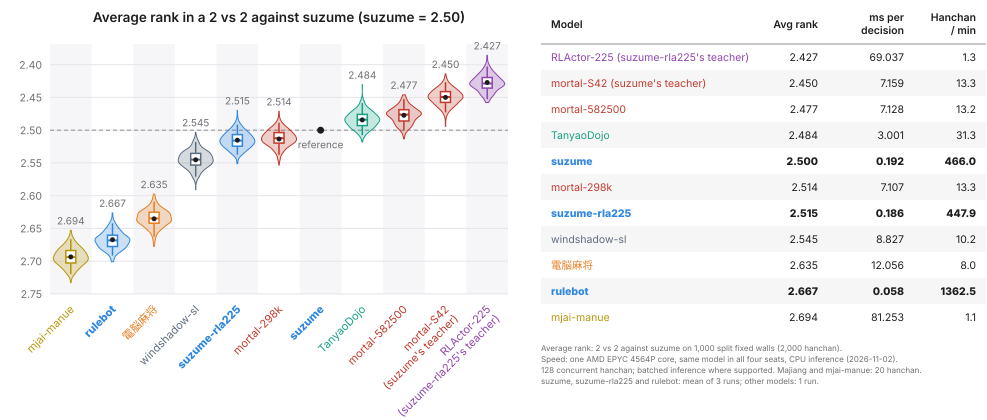

# yamawake-mahjong-arena

[日本語](README.md) | **English**

### Mahjong on duplicated walls

In duplicate bridge every table plays the same deals. This keeps results from
hinging on the luck of the cards, so they measure the difference in skill
between players more accurately. yamawake-mahjong-arena brings the same idea to
measuring mahjong skill.

Every kyoku's wall is fixed, and each seat draws from its own part of the wall
(*split fixed walls*). This way calls and dealer repeats never shift the
scheduled draws: they hold to the end of the game.
The split fixed walls are assigned to the seats and rotated in turn.
Every player plays every split fixed wall once, so differences in results come
only from the players' choices.

> **Important:** A similar scheme, fixing the draws and each kyoku's wall, had
> already been implemented and published in 2020 by Satoshi Kobayashi
> (kobalab), the author of 電脳麻将, as "duplicate mahjong"
> ([デュプリケート麻雀の実装](https://blog.kobalab.net/entry/2020/12/19/075529),
> [majiang-ai](https://github.com/kobalab/majiang-ai)). I only noticed after
> building this one: doing your homework first matters.

### What's in the repository

- **arena**: the split-fixed-wall arena; a Rust game loop runs N games in
  parallel (see [`docs/arena.en.md`](docs/arena.en.md)).
- **rulebot**: a fast rule-based bot, useful as a baseline (see
  [`docs/rulebot.en.md`](docs/rulebot.en.md)).
- **suzume**: a distilled model of a reinforcement-learned mahjong AI
  (Mortal-S42); a light bot built on small per-decision MLPs (see [`docs/suzume.en.md`](docs/suzume.en.md)).
  - **Play-style control**: one number each sets how much suzume pushes, calls and declares riichi, so you
    can field opponents with different play styles (see [Play-style control](#play-style-control-of-suzume)).

On one CPU core (AMD EPYC 4564P, measured on 2026-11-04) it runs at about
1,360 hanchan/min with four rulebots and
about 470 hanchan/min with four suzume bots (128 concurrent hanchan, mean of three runs).
For reference, a Mac (Apple M4 Pro) does about 1,660 (rulebot) and 570
(suzume) hanchan/min on one thread, and about 14,900 and 5,300 hanchan/min on
all its threads (14 cores).
A Python player pays about 55 µs per decision to pass
the observation back and forth, about twice the arena's own time per decision
(about 23 µs); these are earlier measurements on one AMD EPYC 7702 CPU capped at 2.0 GHz.
When you evaluate a very fast algorithm, this overhead can affect
the overall speed (see [`docs/arena.en.md`](docs/arena.en.md)).
The docs under [`docs/`](docs/) are in Japanese.

## Strength of suzume

suzume compared with other models (including the unpublished RLActor-225):
on the left, each model's average rank over 2,000 hanchan of 2 vs 2 against
suzume on split fixed walls; on the right, each model's average time per
decision (a discard or a call) and the hanchan it plays per minute.
Speed was measured pinned to one AMD EPYC 4564P core with its SMT sibling idle,
the same model in all four seats, and CPU-only inference. There were 128 concurrent hanchan,
with batched inference where supported. majiang-ai and mjai-manue played 20 hanchan
(20 and one in flight, respectively). Values for suzume, suzume-rla225 and rulebot
are means of three runs on 2026-11-04; the other models were measured once on 2026-11-02.



- suzume is about as strong as mortal-298k and slightly weaker than
  mortal-582500 (both third-party trained mortal-v4 models) and TanyaoDojo.
- suzume was trained with mortal-S42 as its teacher; it trails its teacher by
  about 0.05 in average rank.
- suzume-rla225 was trained the same way with RLActor-225 (unpublished) as its
  teacher; it is about as strong as suzume (about 0.015 weaker in average rank).
- Time per decision is 0.192 ms for suzume versus 7.16 ms for its teacher
  Mortal-S42, about a 37-fold speedup, and about 16 times as fast as TanyaoDojo (3.00 ms).

Sources of the models compared:

| Model | Source |
|---|---|
| mortal-298k | [VoidShine/mortal-298k](https://huggingface.co/VoidShine/mortal-298k) ([mortal-v4](https://github.com/Equim-chan/Mortal), 298k steps) |
| mortal-582500 | [Yuchen1457/mortal-582500](https://huggingface.co/Yuchen1457/mortal-582500) (mortal-v4, 582,500 steps) |
| mortal-S42 | [haor/Mortal-S42](https://huggingface.co/haor/Mortal-S42) (mortal-v4, S42.8k) |
| TanyaoDojo | `bc_v2_g186.pkl` from [Twu31/TanyaoDojo](https://huggingface.co/Twu31/TanyaoDojo) (code: [twu3202/TanyaoDojo](https://github.com/twu3202/TanyaoDojo)) |
| majiang-ai | [kobalab/majiang-ai](https://github.com/kobalab/majiang-ai) 1.3.0, run by [kobalab/mjai-bot](https://github.com/kobalab/mjai-bot) 2.0.0 |
| mjai-manue | [Apricot-S/mjai-manue-go](https://github.com/Apricot-S/mjai-manue-go) (a Go port of [gimite/mjai-manue](https://github.com/gimite/mjai-manue)) |
| windshadow-sl | [windshadow233/Mahjong-AI](https://github.com/windshadow233/Mahjong-AI) (a reimplementation of the supervised stage of Suphx) |
| rulebot | this repository ([`docs/rulebot.en.md`](docs/rulebot.en.md)) |
| RLActor-225 | unpublished |

## Install

### From a release wheel (no Rust toolchain needed)

Each [release](https://github.com/ShintaroMinami/yamawake-mahjong-arena/releases)
carries wheels for Linux x86_64/aarch64 (manylinux2014) and macOS arm64,
CPython 3.11-3.13.
The Rust core is precompiled in the wheel.
`riichienv` and `numpy` come from PyPI.
``` bash
    gh release download -R ShintaroMinami/yamawake-mahjong-arena -p '*.whl' -D wheels
    pip install --find-links wheels yamawake
```
### From source

Needs Python >= 3.11, a Rust toolchain and [uv](https://docs.astral.sh/uv/).
``` bash
    git clone https://github.com/ShintaroMinami/yamawake-mahjong-arena.git
    cd yamawake-mahjong-arena
    uv sync                # builds the extension (maturin) into .venv
    uv run pytest          # tests
```
Without uv, `pip install git+https://github.com/ShintaroMinami/yamawake-mahjong-arena.git`
also works given a Rust toolchain.

The package is `yamawake` and the command is `yamawake-arena`.

## Usage
``` bash
    uv run yamawake-arena --mode 2v2 --players tsumogiri rulebot --walls 100
    uv run python -m yamawake.arena --mode 1v3 --players suzume rulebot
```
The results go to stdout as tables: rank and points, per-kyoku win, deal-in,
call and riichi rates, hand points and adjusted efficiency, and the time each
player and the arena itself took (see [`docs/arena.en.md`](docs/arena.en.md#2-command-line)).

From Python:
``` python
    from yamawake import RulebotAgent, TsumogiriAgent, run_match
    r = run_match([TsumogiriAgent(), RulebotAgent(), RulebotAgent(), RulebotAgent()], walls=100)
    print(r.table())
```

| Player | Description |
|---|---|
| `tsumogiri` | a bot that discards every draw |
| `rulebot` | the fast rule-based bot |
| `suzume` | a light, reasonably strong bot (per-decision 3-layer MLPs taught by Mortal-S42) |
| `suzume-rla225` | the same build as `suzume`, taught by RLActor-225 (unpublished) |

## Arena settings

By default the arena plays to the benchmark specification for comparing strength: fixed split walls played through every seat rotation, on the standard walls. Three settings decide how the walls are used.

| Setting | `run_match` argument | Command line | Default |
|---|---|---|---|
| Fixed walls: one wall is played by everyone once, with the seats rotated | `rotate` | `--no-rotate` for `False` | `True` |
| Split walls: each seat draws from its own wall (calls do not shift the draws) | `split_wall` | `--no-split` for `False` | `True` |
| Wall randomness: which walls are used | `wall_base` | `--wall-base` | `0` (standard walls) |

- The standard walls are 5,000 walls generated from `wall_base` 0; a run uses the first `walls` of them (1,000 by default). `FRESH` (`fresh` on the command line) draws new walls, and an integer reproduces the walls generated from that value. The `wall_base` used is shown on the first line of the result table.
- **Benchmark (default)**: `rotate=True`, `split_wall=True`, `wall_base=0`. Everyone plays the same walls under the same conditions, so differences in results come only from the players' choices. As long as the standard walls are used, results from different runs are compared on the same walls.
- **Ordinary random walls**: pass `rotate=False`, `split_wall=False`, `wall_base=FRESH`. With split walls, calls do not shift the draws, so the flow of draws differs from ordinary mahjong. To see results or play statistics as ordinary mahjong, switch all three.

``` bash
    uv run yamawake-arena --mode 1v3 --players suzume rulebot --no-rotate --no-split --wall-base fresh
```
``` python
    from yamawake import FRESH, RulebotAgent, SuzumeAgent, lineup, run_match
    r = run_match(lineup(SuzumeAgent(), RulebotAgent(), "1v3"), rotate=False, split_wall=False, wall_base=FRESH)
```
- With these settings, each wall is played for one hanchan only, and every hanchan is independent of the others. Standard errors are then per hanchan.

## Play-style control of suzume

### By style coordinates

`suzume`'s style can be given in three coordinates measured against the spread of human players.

| Coordinate | Meaning | Value |
|---|---|---|
| `call_rate` | per-kyoku call rate: kyoku with a call / kyoku where a call (chi, pon, open kan) was possible | 0 to 1; default `suzume` about 0.294 |
| `riichi_rate` | per-kyoku riichi rate: kyoku with riichi / kyoku where riichi was possible | 0 to 1; default `suzume` about 0.659 |
| `push_z` | pushing against an opponent's riichi (push z) | 0 = default `suzume`, 1 = one standard deviation of Tenhou Houou players; positive pushes more, negative folds more |

``` bash
    # the median of Houou players (500+ games, 1,233 players)
    uv run yamawake-arena --mode 1v3 --players suzume:call_rate=0.364:riichi_rate=0.670:push_z=-0.78 suzume
```
``` python
    from yamawake import SuzumeAgent
    agent = SuzumeAgent({"call_rate": 0.45, "push_z": 1.0})
```
- A coordinate left out stays at default `suzume`'s value.
- The coordinates are converted into the three parameters below when the agent is built (calibration,
  `yamawake.style.calibrate`). The conversion was fitted on 729 settings played against three default `suzume`
  (2,000 hanchan each); against other opponents the style played drifts somewhat.
- An unreachable target (such as an extreme push z) warns and plays the nearest style. A target that needs a
  parameter outside the fitted -1 to 1 warns that it is an extrapolation.
- Coordinates and parameters cannot be mixed. Only `suzume` takes the coordinates.

### By parameters

`suzume` has three parameters that set its play style.
All three default to 0 (no change); at 0, `suzume` plays as before.

| Parameter | Controls | Value |
|---|---|---|
| `aggression` | push / fold | -1 to 1; positive pushes more (more deal-ins and wins), negative folds more |
| `call_shift` | how often it calls | standard -1 to 1 (values beyond are allowed); positive calls more, negative less |
| `riichi_shift` | how often it declares riichi | standard -1 to 1 (values beyond are allowed); positive declares more, negative stays dama more |

Append them to the player spec as `:name=value`:
``` bash
    uv run yamawake-arena --mode 2v2 --players suzume:aggression=0.5 suzume
    uv run yamawake-arena --mode 2v2 --players suzume:aggression=-0.5:call_shift=0.5:riichi_shift=-0.5 suzume
```
``` python
    from yamawake import SuzumeAgent
    agent = SuzumeAgent({"aggression": 0.5, "call_shift": 0.5})
```
- `aggression` mixes suzume's policy with one of two models fitted on the teacher's (Mortal-S42) pushing or folding
  policy in positions with a threat, such as an opponent's riichi. 1 plays like the push model, -1 like the fold
  model.
- `call_shift` moves the score of every call (chi, pon, open kan) and `riichi_shift` that of riichi. Over the
  decisions where it may call (declare), +-1 multiplies the odds of calling by about e^1.5 (1/e^1.5) and of declaring
  by about e^3 (1/e^3).
- The aim is opponents with different styles, not a stronger bot. The further from 0, the somewhat worse
  the results against `suzume`.
- Only `suzume` has these parameters (`suzume-rla225` does not). See [`docs/suzume.en.md`](docs/suzume.en.md#adjusting-the-play-style).

## Playing your own agent

An agent is any object with `lane = "observation"`, `act_batch(decisions)` and
`describe()`, implemented as follows.
- `act_batch` receives `decisions`, the decisions of every game waiting on
  that agent, as a list (so a model can batch its inference).
- Each decision `d` in `decisions` carries the observation `d.obs` (a
  `riichienv.Observation`, including the legal moves, hand, rivers, scores and
  more), the kyoku's mjai-format events `d.kyoku_events`, and more.
- Pick one legal action per decision and return them as a list, `actions`.

```python
    import riichienv as rv
    from yamawake import RulebotAgent, lineup, run_match

    class MyAgent:
        lane = "observation"

        def act_batch(self, decisions):
            actions = []
            for d in decisions:
                legal = d.obs.legal_actions()
                # win when possible, else the first legal action
                win = [a for a in legal if a.action_type in (rv.ActionType.TSUMO, rv.ActionType.RON)]
                actions.append(win[0] if win else legal[0])
            return actions

        def describe(self):
            return {"kind": "mine", "name": "my-agent"}

    r = run_match(lineup(MyAgent(), RulebotAgent(), "2v2"), walls=100)   # MyAgent x 2 vs rulebot x 2
    print(r.table())
```

Registering a name with `register_agent("my-agent", lambda spec, **opts: MyAgent())`
lets you name it within the same process, as in
`yamawake.arena.main(["--players", "my-agent", "rulebot", ...])`. To use it from
the `yamawake-arena` command, put the registering function in your package's
`yamawake.agents` entry-point group. For what a decision carries and a fuller
example, see [`docs/arena.en.md`](docs/arena.en.md#4-your-own-player).

For more, including the low-level loop, single-position decisions (`decide`),
log statistics (`handstats`) and the Tenhou replay converter (`tenhou6`), see
[`docs/arena.en.md`](docs/arena.en.md).

## Acknowledgements

This project draws on the repositories and writings below. Our heartfelt
thanks to their authors and developers for the excellent software and
insights they share.

- **[RiichiEnv](https://github.com/smly/RiichiEnv)** by smly (Apache-2.0) is the
  simulator's foundation. yamawake-mahjong-arena's game engine is a vendored fork of
  riichienv-core 0.4.8 that adds per-seat draw queues and an explicit
  (kyoku, honba) wall table ([`src/engine/README.md`](src/engine/README.md)), and the Python side uses
  the `riichienv` package.
- **[電脳麻将 (Majiang)](https://github.com/kobalab/Majiang)** by Satoshi Kobayashi (kobalab;
  [majiang-ai](https://github.com/kobalab/majiang-ai), MIT, and the wider
  電脳麻将 project): the rulebot's design references it.
  [`src/rust/rulebot/kobalab_ev.rs`](src/rust/rulebot/kobalab_ev.rs) is a port of majiang-ai's `eval_shoupai` /
  `eval_fulou`, the call logic follows its `select_fulou` and the kan logic
  its `select_gang`.
- The algorithm for valuing hands (dynamic programming, DP):
  - Source of the method: [tomohxx](https://github.com/tomohxx)'s *Mahjong Algorithm* book
    ([ch. 6, win probability](https://tomohxx.github.io/mahjong-algorithm-book/probability/)).
  - Consulted to understand and implement it: the explanations of
    [nekobean](https://github.com/nekobean)'s [mahjong-cpp](https://github.com/nekobean/mahjong-cpp).
    Some implementation details follow libriichi ([Mortal](https://github.com/Equim-chan/Mortal)).
  - Our own extensions: ron, furiten, and the distinction between dama and riichi.

  No code from any of them is included.
- Also used, with thanks: through riichienv-core, the shanten tables of
  [Nyanten](https://github.com/Cryolite/nyanten) (MIT).

See [`docs/THIRD_PARTY_NOTICES.md`](docs/THIRD_PARTY_NOTICES.md) for their full license texts.

## License

This repository is licensed under MIT ([`LICENSE`](LICENSE)). The vendored riichienv-core
is Apache-2.0 ([`src/engine/riichienv-core/LICENSE`](src/engine/riichienv-core/LICENSE)).
