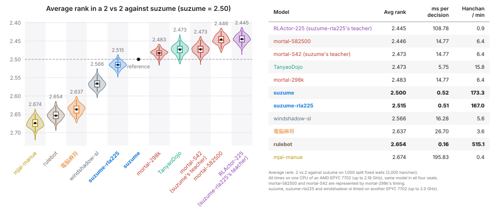

# yamawake-mahjong-arena

[日本語](README.md) | **English**

### Mahjong on duplicated walls

In duplicate bridge every table plays the same deals. This keeps results from
hinging on the luck of the cards, so they measure the difference in skill
between players more accurately. yamawake-mahjong-arena brings the same idea to
measuring mahjong skill.

Every kyoku's wall is fixed, and each seat draws from its own part of the wall
(*split fixed walls*). This way calls and dealer repeats never shift the
scheduled draws: they hold to the end of the game.
The split fixed walls are assigned to the seats and rotated in turn.
Every player plays every split fixed wall once, so differences in results come
only from the players' choices.

> **Important:** A similar scheme, fixing the draws and each kyoku's wall, had
> already been implemented and published in 2020 by Satoshi Kobayashi
> (kobalab), the author of 電脳麻将, as "duplicate mahjong"
> ([デュプリケート麻雀の実装](https://blog.kobalab.net/entry/2020/12/19/075529),
> [majiang-ai](https://github.com/kobalab/majiang-ai)). I only noticed after
> building this one: doing your homework first matters.

### What's in the repository

- **arena**: the split-fixed-wall arena; a Rust game loop runs N games in
  parallel (see [`docs/arena.md`](docs/arena.md)).
- **rulebot**: a fast rule-based bot, useful as a baseline (see
  [`docs/rulebot.md`](docs/rulebot.md)).
- **suzume**: a distilled model of a reinforcement-learned mahjong AI
  (Mortal-S42); a light bot built on small per-decision MLPs (see [`docs/suzume.md`](docs/suzume.md)).
  - **Play-style control**: one number each sets how much suzume pushes, calls and declares riichi, so you
    can field opponents with different play styles (see [Play-style control](#play-style-control-of-suzume)).

On one CPU (an AMD EPYC 7702, measured at up to 2.18 GHz) it runs at about
515 hanchan/min with four rulebots and
about 170 hanchan/min with four suzume bots.
For reference, a Mac (Apple M4 Pro) does about 1,200 (rulebot) and 400
(suzume) hanchan/min on one thread, and about 10,000 and 3,700 hanchan/min on
all its threads (14 cores).
A Python player pays about 55 µs per decision (on the same EPYC CPU) to pass
the observation back and forth, about twice the arena's own time per decision
(about 23 µs). When you evaluate a very fast algorithm, this overhead can affect
the overall speed (see [`docs/arena.md`](docs/arena.md)).
The docs under [`docs/`](docs/) are in Japanese.

## Strength of suzume

suzume compared with other publicly available models:
on the left, each model's average rank over 2,000 hanchan of 2 vs 2 against
suzume on split fixed walls; on the right, each model's average time per
decision (a discard or a call) and the hanchan it plays per minute.



- suzume is about as strong as mortal-298k and slightly weaker than
  mortal-582500 (both third-party trained mortal-v4 models) and TanyaoDojo.
- suzume was trained with mortal-S42 as its teacher; it trails its teacher by
  about 0.05 in average rank.
- suzume-rla225 was trained the same way with RLActor-225 (unpublished) as its
  teacher; it is about as strong as suzume (about 0.015 weaker in average rank).
- It runs about 10 times as fast as TanyaoDojo and about 30 times as fast as
  mortal-v4.

Sources of the models compared:

| Model | Source |
|---|---|
| mortal-298k | [VoidShine/mortal-298k](https://huggingface.co/VoidShine/mortal-298k) ([mortal-v4](https://github.com/Equim-chan/Mortal), 298k steps) |
| mortal-582500 | [Yuchen1457/mortal-582500](https://huggingface.co/Yuchen1457/mortal-582500) (mortal-v4, 582,500 steps) |
| mortal-S42 | [haor/Mortal-S42](https://huggingface.co/haor/Mortal-S42) (mortal-v4, S42.8k) |
| TanyaoDojo | `bc_v2_g186.pkl` from [Twu31/TanyaoDojo](https://huggingface.co/Twu31/TanyaoDojo) (code: [twu3202/TanyaoDojo](https://github.com/twu3202/TanyaoDojo)) |
| 電脳麻将 (Majiang) | [kobalab/majiang-ai](https://github.com/kobalab/majiang-ai) 1.3.0, run by [kobalab/mjai-bot](https://github.com/kobalab/mjai-bot) 2.0.0 |
| mjai-manue | [Apricot-S/mjai-manue-go](https://github.com/Apricot-S/mjai-manue-go) (a Go port of [gimite/mjai-manue](https://github.com/gimite/mjai-manue)) |
| windshadow-sl | [windshadow233/Mahjong-AI](https://github.com/windshadow233/Mahjong-AI) (a reimplementation of the supervised stage of Suphx) |
| rulebot | this repository ([`docs/rulebot.md`](docs/rulebot.md)) |
| RLActor-225 | unpublished |

## Install

### From a release wheel (no Rust toolchain needed)

Each [release](https://github.com/ShintaroMinami/yamawake-mahjong-arena/releases)
carries wheels for Linux x86_64/aarch64 (manylinux2014) and macOS arm64,
CPython 3.11-3.13.
The Rust core is precompiled in the wheel.
`riichienv` and `numpy` come from PyPI.
``` bash
    gh release download -R ShintaroMinami/yamawake-mahjong-arena -p '*.whl' -D wheels
    pip install --find-links wheels yamawake
```
### From source

Needs Python >= 3.11, a Rust toolchain and [uv](https://docs.astral.sh/uv/).
``` bash
    git clone https://github.com/ShintaroMinami/yamawake-mahjong-arena.git
    cd yamawake-mahjong-arena
    uv sync                # builds the extension (maturin) into .venv
    uv run pytest          # tests
```
Without uv, `pip install git+https://github.com/ShintaroMinami/yamawake-mahjong-arena.git`
also works given a Rust toolchain.

The package is `yamawake` and the command is `yamawake-arena`.

## Usage
``` bash
    uv run yamawake-arena --mode 2v2 --players tsumogiri rulebot --walls 100
    uv run python -m yamawake.arena --mode 1v3 --players suzume rulebot
```
The results go to stdout as tables: rank and points, per-kyoku win, deal-in,
call and riichi rates, hand points and adjusted efficiency, and the time each
player and the arena itself took (see [`docs/arena.md`](docs/arena.md#2-コマンドライン)).

From Python:
``` python
    from yamawake import RulebotAgent, TsumogiriAgent, run_match
    r = run_match([TsumogiriAgent(), RulebotAgent(), RulebotAgent(), RulebotAgent()], walls=100)
    print(r.table())
```

| Player | Description |
|---|---|
| `tsumogiri` | a bot that discards every draw |
| `rulebot` | the fast rule-based bot |
| `suzume` | a light, reasonably strong bot (per-decision 3-layer MLPs taught by Mortal-S42) |
| `suzume-rla225` | the same build as `suzume`, taught by RLActor-225 (unpublished) |

## Play-style control of suzume

`suzume` has three parameters that set its play style.
All three default to 0 (no change); at 0, `suzume` plays as before.

| Parameter | Controls | Value |
|---|---|---|
| `aggression` | push / fold | -1 to 1; positive pushes more (more deal-ins and wins), negative folds more |
| `call_shift` | how often it calls | standard -1 to 1 (values beyond are allowed); positive calls more, negative less |
| `riichi_shift` | how often it declares riichi | standard -1 to 1 (values beyond are allowed); positive declares more, negative stays dama more |

Append them to the player spec as `:name=value`:
``` bash
    uv run yamawake-arena --mode 2v2 --players suzume:aggression=0.5 suzume
    uv run yamawake-arena --mode 2v2 --players suzume:aggression=-0.5:call_shift=0.5:riichi_shift=-0.5 suzume
```
``` python
    from yamawake import SuzumeAgent
    agent = SuzumeAgent({"aggression": 0.5, "call_shift": 0.5})
```
- `aggression` mixes suzume's policy with one of two models fitted on the teacher's (Mortal-S42) pushing or folding
  policy in positions with a threat, such as an opponent's riichi. 1 plays like the push model, -1 like the fold
  model.
- `call_shift` moves the score of every call (chi, pon, open kan) and `riichi_shift` that of riichi. Over the
  decisions where it may call (declare), +-1 multiplies the odds of calling by about e^1.5 (1/e^1.5) and of declaring
  by about e^3 (1/e^3).
- The aim is opponents with different styles, not a stronger bot. The further from 0, the somewhat worse
  the results against `suzume`.
- Only `suzume` has these parameters (`suzume-rla225` does not). See [`docs/suzume.md`](docs/suzume.md#打ち方の調節).

## Playing your own agent

An agent is any object with `lane = "observation"`, `act_batch(decisions)` and
`describe()`, implemented as follows.
- `act_batch` receives `decisions`, the decisions of every game waiting on
  that agent, as a list (so a model can batch its inference).
- Each decision `d` in `decisions` carries the observation `d.obs` (a
  `riichienv.Observation`, including the legal moves, hand, rivers, scores and
  more), the kyoku's mjai-format events `d.kyoku_events`, and more.
- Pick one legal action per decision and return them as a list, `actions`.

```python
    import riichienv as rv
    from yamawake import RulebotAgent, lineup, run_match

    class MyAgent:
        lane = "observation"

        def act_batch(self, decisions):
            actions = []
            for d in decisions:
                legal = d.obs.legal_actions()
                # win when possible, else the first legal action
                win = [a for a in legal if a.action_type in (rv.ActionType.TSUMO, rv.ActionType.RON)]
                actions.append(win[0] if win else legal[0])
            return actions

        def describe(self):
            return {"kind": "mine", "name": "my-agent"}

    r = run_match(lineup(MyAgent(), RulebotAgent(), "2v2"), walls=100)   # MyAgent x 2 vs rulebot x 2
    print(r.table())
```

Registering a name with `register_agent("my-agent", lambda spec, **opts: MyAgent())`
lets you name it within the same process, as in
`yamawake.arena.main(["--players", "my-agent", "rulebot", ...])`. To use it from
the `yamawake-arena` command, put the registering function in your package's
`yamawake.agents` entry-point group. For what a decision carries and a fuller
example, see [`docs/arena.md`](docs/arena.md#4-自作のプレイヤー).

For more, including the low-level loop, single-position decisions (`decide`),
log statistics (`handstats`) and the Tenhou replay converter (`tenhou6`), see
[`docs/arena.md`](docs/arena.md).

## Acknowledgements

This project draws on the repositories and writings below. Our heartfelt
thanks to their authors and developers for the excellent software and
insights they share.

- **[RiichiEnv](https://github.com/smly/RiichiEnv)** by smly (Apache-2.0) is the
  simulator's foundation. yamawake-mahjong-arena's game engine is a vendored fork of
  riichienv-core 0.4.8 that adds per-seat draw queues and an explicit
  (kyoku, honba) wall table ([`src/engine/README.md`](src/engine/README.md)), and the Python side uses
  the `riichienv` package.
- **[電脳麻将 (Majiang)](https://github.com/kobalab/Majiang)** by Satoshi Kobayashi (kobalab;
  [majiang-ai](https://github.com/kobalab/majiang-ai), MIT, and the wider
  電脳麻将 project): the rulebot's design references it.
  [`src/rust/rulebot/kobalab_ev.rs`](src/rust/rulebot/kobalab_ev.rs) is a port of majiang-ai's `eval_shoupai` /
  `eval_fulou`, the call logic follows its `select_fulou` and the kan logic
  its `select_gang`.
- The algorithm for valuing hands (dynamic programming, DP) implements the method of
  [tomohxx](https://github.com/tomohxx)'s *Mahjong Algorithm* book
  ([ch. 6, win probability](https://tomohxx.github.io/mahjong-algorithm-book/probability/)),
  following the explanations of [nekobean](https://github.com/nekobean)'s
  [mahjong-cpp](https://github.com/nekobean/mahjong-cpp). Some implementation
  details follow libriichi ([Mortal](https://github.com/Equim-chan/Mortal)).
- Also used, with thanks: through riichienv-core, the shanten tables of
  [Nyanten](https://github.com/Cryolite/nyanten) (MIT).

See [`docs/THIRD_PARTY_NOTICES.md`](docs/THIRD_PARTY_NOTICES.md) for their full license texts.

## License

This repository is licensed under MIT ([`LICENSE`](LICENSE)). The vendored riichienv-core
is Apache-2.0 ([`src/engine/riichienv-core/LICENSE`](src/engine/riichienv-core/LICENSE)).
