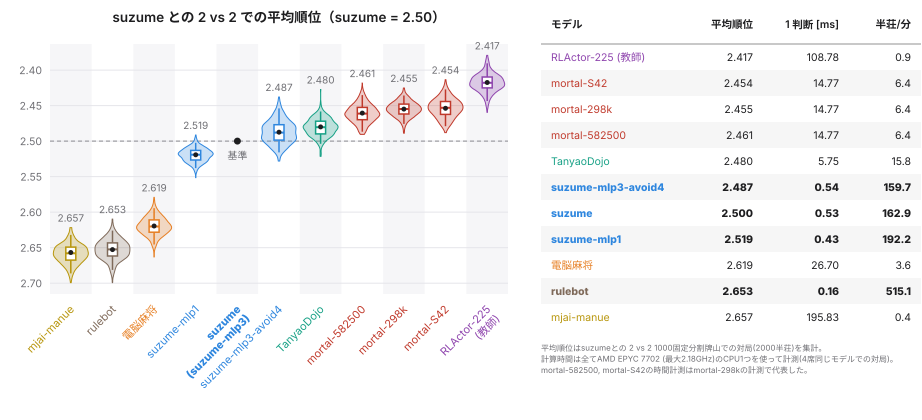

# yamawake-mahjong-arena

**日本語** | [English](README.en.md)

### 複製牌山での麻雀

手札複製ブリッジ(Duplicate Bridge)では、全卓が同じ手札構成でプレイします。これは、対戦結果が手札の運に左右されずプレイヤーの実力差をより正確に測ることを目指した工夫です。yamawake-mahjong-arena は麻雀の実力測定に同じ工夫を導入します。

　対局の各局の牌山を固定し、各席が自分専用の山からツモります（*固定分割牌山*）。このようにすることで、ゲーム中に発生する副露や連荘によって予定されたツモ牌がずれることなく最後まで維持されます。
この固定分割牌山を席ごとに割り当て、順に回して使用します。
全プレイヤーが全ての固定分割牌山を１度ずつ使用することで、結果の違いがプレイヤーの選択だけから生じるようにしています。

>　**重要 :** なお、ツモと局ごとの牌山を固定する同様の対局方式は、電脳麻将の作者である小林聡（kobalab）氏が 2020 年に「デュプリケート麻雀」として既に実装し、公開されていました（[デュプリケート麻雀の実装](https://blog.kobalab.net/entry/2020/12/19/075529)、[majiang-ai](https://github.com/kobalab/majiang-ai)）。実装してから気づきましたが、下調べは大事です。

### リポジトリの主な内容

- **arena**：固定分割牌山の対戦環境。Rust の対局ループで N 局を並列に進めます（[`docs/arena.md`](docs/arena.md)を参照）。
- **rulebot**：高速なルールベースのボット。ベースラインとして有用です（[`docs/rulebot.md`](docs/rulebot.md)を参照）。
- **suzume**：強化学習した麻雀AI（Mortal-S42）の蒸溜モデル。判断ごとの小さな MLP を用いた軽量のボット（[`docs/suzume.md`](docs/suzume.md)を参照）。
  - **打ち方の調節**：押し引き・副露・立直の度合いを、それぞれ 1 つの数値で調節できます。打ち方の違う対戦相手を自由に作れます（[打ち方の調節](#suzume-の打ち方の調節)を参照）。

1 CPU（AMD EPYC 7702、最大 2.18 GHz で計測）を使用した場合、
rulebot 4 体なら約 515 半荘/分、
suzume 4 体なら約 170 半荘/分 で動作します。
参考として、Mac（Apple M4 Pro）では 1 スレッドで rulebot 4 体が約 1,200 半荘/分、suzume 4 体が約 400 半荘/分、全てのスレッド（14 コア）を使うと rulebot 4 体が約 10,000 半荘/分、suzume 4 体が約 3,700 半荘/分です。
Python のプレイヤーは、判断 1 回ごとに観測の受け渡しで約 55 µs かかります（同じ EPYC の 1 CPU）。これは、arena対局の1判断あたりのシステム時間（約 23 µs）の2倍程度に相当します。非常に高速なアルゴリズムを評価する場合は、この時間が全体の速さに影響する可能性があります（[`docs/arena.md`](docs/arena.md)を参照）。

## suzume の性能

suzume と現在公開されている他のモデルとの性能比較は以下の通りです。
左図は suzume との 2 vs 2 で2000半荘の分割固定牌山対局を行って計算した他モデルの平均順位、右の表はモデルごとの 1 判断(打牌や副露)にかかる平均時間と1分間に処理できる半荘数の比較です。



- suzumeは、mortal-v4の第三者学習モデルのうちmortal-298kとほぼ同じ強さで、mortal-582500やTanyaoDojoより少し弱い程度の性能です。
- suzumeはmortal-S42を教師として学習したモデルで、教師との差は平均順位で0.05程度です。
- suzume-rla225はRLActor-225(未公開)を教師として同じ方法で学習したモデルで、suzumeとほぼ同じ強さです（平均順位で0.015程度弱い）。
- 速度はTanyaoDojoの10倍程度、mortal-v4の30倍程度と高速に動作します。

比較したモデルの出典：

| モデル | 出典 |
|---|---|
| mortal-298k | [VoidShine/mortal-298k](https://huggingface.co/VoidShine/mortal-298k)（[mortal-v4](https://github.com/Equim-chan/Mortal)、298k ステップ） |
| mortal-582500 | [Yuchen1457/mortal-582500](https://huggingface.co/Yuchen1457/mortal-582500)（mortal-v4、582,500 ステップ） |
| mortal-S42 | [haor/Mortal-S42](https://huggingface.co/haor/Mortal-S42)（mortal-v4、S42.8k） |
| TanyaoDojo | [Twu31/TanyaoDojo](https://huggingface.co/Twu31/TanyaoDojo) の `bc_v2_g186.pkl`（コード：[twu3202/TanyaoDojo](https://github.com/twu3202/TanyaoDojo)） |
| 電脳麻将 | [kobalab/majiang-ai](https://github.com/kobalab/majiang-ai) 1.3.0 を [kobalab/mjai-bot](https://github.com/kobalab/mjai-bot) 2.0.0 で実行 |
| mjai-manue | [Apricot-S/mjai-manue-go](https://github.com/Apricot-S/mjai-manue-go)（[gimite/mjai-manue](https://github.com/gimite/mjai-manue) の Go 移植） |
| windshadow-sl | [windshadow233/Mahjong-AI](https://github.com/windshadow233/Mahjong-AI)（Suphx の教師あり学習の部分の再現） |
| rulebot | このリポジトリ（[`docs/rulebot.md`](docs/rulebot.md)） |
| RLActor-225 | 未公開 |


## インストール

### リリースの wheel から（Rust の環境は不要）

各 [リリース](https://github.com/ShintaroMinami/yamawake-mahjong-arena/releases) に、Linux x86_64/aarch64（manylinux2014）と macOS arm64、CPython 3.11〜3.13 の wheel があります。
Rust の部分は wheel の中にビルド済みです。
`riichienv` と `numpy` は PyPI から入ります。
``` bash
    gh release download -R ShintaroMinami/yamawake-mahjong-arena -p '*.whl' -D wheels
    pip install --find-links wheels yamawake
```
### ソースから

Python 3.11 以上、Rust の環境、[uv](https://docs.astral.sh/uv/) が必要です。
``` bash
    git clone https://github.com/ShintaroMinami/yamawake-mahjong-arena.git
    cd yamawake-mahjong-arena
    uv sync                # 拡張を（maturin で）.venv にビルド
    uv run pytest          # テスト
```
uv を使わずに、Rust の環境があれば `pip install git+https://github.com/ShintaroMinami/yamawake-mahjong-arena.git` でも入ります。

パッケージの名前は `yamawake`、コマンドの名前は `yamawake-arena` です。

## 使い方
``` bash
    uv run yamawake-arena --mode 2v2 --players tsumogiri rulebot --walls 100
    uv run python -m yamawake.arena --mode 1v3 --players suzume rulebot
```    
結果は、順位とポイント、1 局あたりの和了率・放銃率・副露率・立直率、平均打点と調整打点効率、プレイヤーごとと arena 自体の計算時間を、表にまとめて標準出力に出します（[`docs/arena.md`](docs/arena.md#2-コマンドライン)）。

Python からの利用は以下のように行います。
``` python
    from yamawake import RulebotAgent, TsumogiriAgent, run_match
    r = run_match([TsumogiriAgent(), RulebotAgent(), RulebotAgent(), RulebotAgent()], walls=100)
    print(r.table())
```

| プレイヤー | 説明 |
|---|---|
| `tsumogiri` | ツモ切りボット |
| `rulebot` | ルールベースの高速ボット |
| `suzume` | 軽量かつある程度強いボット（Mortal-S42 を教師に学習した、判断ごとの 3 層の MLP） |
| `suzume-rla225` | `suzume` と同じ作りで、RLActor-225（未公開）を教師に学習したボット |

## suzume の打ち方の調節

`suzume` には、打ち方を調節する 3 つのパラメータがあります。
既定ではどれも 0（調節なし）で、0 のときはこれまでの `suzume` と同じに打ちます。

| パラメータ | 調節するもの | 値 |
|---|---|---|
| `aggression` | 押し引き | -1 〜 1。正で押し寄り（放銃率・和了率が上がる）、負で降り寄り |
| `call_shift` | 副露の度合い | 標準は -1 〜 1（外側も指定できる）。正で鳴きやすく、負で鳴きにくくなる |
| `riichi_shift` | 立直の度合い | 標準は -1 〜 1（外側も指定できる）。正で立直しやすく、負でダマに寄る |

プレイヤーの指定に `:名前=値` で付けます。
``` bash
    uv run yamawake-arena --mode 2v2 --players suzume:aggression=0.5 suzume
    uv run yamawake-arena --mode 2v2 --players suzume:aggression=-0.5:call_shift=0.5:riichi_shift=-0.5 suzume
```
``` python
    from yamawake import SuzumeAgent
    agent = SuzumeAgent({"aggression": 0.5, "call_shift": 0.5})
```
- `aggression` は、`suzume` の方策に、押しのモデルか降りのモデルの方策を混ぜます。この 2 つのモデルは、他家の立直などの脅威がある局面で教師（Mortal-S42）が押したとき・降りたときの方策を学習したものです。1 で押しのモデル、-1 で降りのモデルの打ち方になります。
- `call_shift` は副露（チー・ポン・大明槓）の、`riichi_shift` は立直の選択肢のスコアを動かします。鳴ける（立直できる）判断で鳴く（立直する）オッズが、±1 で `call_shift` はおよそ e^1.5 倍（1/e^1.5 倍）、`riichi_shift` はおよそ e³ 倍（1/e³ 倍）になります。
- 調節の目的は打ち方の違う相手を作ることで、強くすることではありません。0 から離すほど、`suzume` との対戦成績は少しずつ下がります。
- 3 つのパラメータを持つのは `suzume` だけです（`suzume-rla225` にはありません）。詳しくは [`docs/suzume.md`](docs/suzume.md#打ち方の調節) を参照してください。

## 自作のプレイヤーとの対局

プレイヤーは、`lane = "observation"`、`act_batch(decisions)`、`describe()` を持つ任意のオブジェクトとし、以下のように実装します。
- `act_batch` では、そのプレイヤーの手番を待つ全ての対局の判断`decisions`をリストとして受ける。(リストとして渡されるのでモデルはまとめて推論できます)
- `decisions` の各判断 `d` は、観測 `d.obs`（`riichienv.Observation`。合法手・手牌・河・点数など含む）と、その局の mjai 形式のイベント `d.kyoku_events` などを持つ。
- 判断ごとに合法手から 1 つを選んで、`actions`としてリストを返す。

```python
    import riichienv as rv
    from yamawake import RulebotAgent, lineup, run_match

    class MyAgent:
        lane = "observation"

        def act_batch(self, decisions):
            actions = []
            for d in decisions:
                legal = d.obs.legal_actions()
                # 和了できれば和了、それ以外は最初の合法手
                win = [a for a in legal if a.action_type in (rv.ActionType.TSUMO, rv.ActionType.RON)]
                actions.append(win[0] if win else legal[0])
            return actions

        def describe(self):
            return {"kind": "mine", "name": "my-agent"}

    r = run_match(lineup(MyAgent(), RulebotAgent(), "2v2"), walls=100)   # MyAgent x 2 対 rulebot x 2
    print(r.table())
```

`register_agent("my-agent", lambda spec, **opts: MyAgent())` で名前を登録すると、同じプロセスの中で `yamawake.arena.main(["--players", "my-agent", "rulebot", ...])` のように名前で指定できます。`yamawake-arena` コマンドから使うには、自作のパッケージのエントリポイントのグループ `yamawake.agents` に登録の関数を置きます。判断に使える情報の一覧と、より詳しいコード例は [`docs/arena.md`](docs/arena.md#4-自作のプレイヤー) にあります。


その他、低水準のループ、1 局面の判断（`decide`）、牌譜の統計（`handstats`）と天鳳の牌譜への変換（`tenhou6`）など、詳細は [`docs/arena.md`](docs/arena.md) を参照してください。

## 謝辞

以下のリポジトリや文章を参考にしています。
素晴らしいソフトウェアや知見を提供してくださった著者/開発者の方々に心から感謝いたします。

- **[RiichiEnv](https://github.com/smly/RiichiEnv)**（smly、Apache-2.0）がシミュレータの土台となっています。yamawake-mahjong-arena の対局エンジンは riichienv-core 0.4.8 を取り込んだ fork で、席ごとのツモの列と、明示的な（局、本場）の牌山表を追加したバージョンです（[`src/engine/README.md`](src/engine/README.md)）。Python 側は `riichienv` パッケージを使います。
- **[電脳麻将](https://github.com/kobalab/Majiang)**（小林聡 / kobalab。[majiang-ai](https://github.com/kobalab/majiang-ai)、MIT、および電脳麻将のプロジェクト全体）：rulebot の設計はこちらのリポジトリを参考にしています。[`src/rust/rulebot/kobalab_ev.rs`](src/rust/rulebot/kobalab_ev.rs) は majiang-ai の `eval_shoupai` / `eval_fulou` の移植で、副露の判断は `select_fulou` を、カンの判断は `select_gang` を参考にしています。
- 手牌価値計算のためのアルゴリズム(動的計画法,DP)は、[tomohxx](https://github.com/tomohxx) の『麻雀アルゴリズム』（[6 章 和了確率](https://tomohxx.github.io/mahjong-algorithm-book/probability/)）の手法を、[nekobean](https://github.com/nekobean) の [mahjong-cpp](https://github.com/nekobean/mahjong-cpp) の解説に沿って実装しています。細かな実装の一部は libriichi（[Mortal](https://github.com/Equim-chan/Mortal)）を参考にしました。
- ほかに、riichienv-core を通して [Nyanten](https://github.com/Cryolite/nyanten)（MIT）の向聴表を使わせていただいています。

これらのライセンスの全文は [`docs/THIRD_PARTY_NOTICES.md`](docs/THIRD_PARTY_NOTICES.md) にあります。

## ライセンス

このリポジトリのライセンスは MIT（[`LICENSE`](LICENSE)）です。取り込んだ riichienv-core は Apache-2.0（[`src/engine/riichienv-core/LICENSE`](src/engine/riichienv-core/LICENSE)）です。

