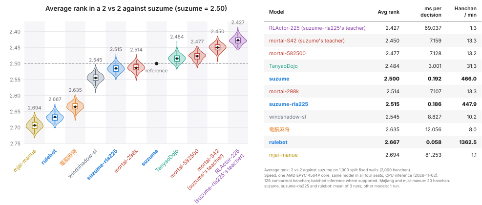

# suzume: policy distillation into small per-decision MLPs

[日本語](suzume.md) | **English**

suzume is a lightweight agent that distills the policy of [Mortal-S42](https://huggingface.co/haor/Mortal-S42) (the teacher), a mahjong agent trained by reinforcement learning, into small MLPs, one per decision type.
Typical reinforcement learning agents need too much computation to play large numbers of games in the arena,
so suzume was developed to provide "an opponent that plays fast at a strength close to reinforcement learning agents".

- Code: [`src/rust/suzume/a1.rs`](../src/rust/suzume/a1.rs) (decisions), [`src/rust/suzume/universal.rs`](../src/rust/suzume/universal.rs) (option features), [`src/rust/suzume/fold_model.rs`](../src/rust/suzume/fold_model.rs) (danger features)
- Models: [`params/suzume/`](../params/suzume/) (embedded at build time)

## 1. Usage

``` bash
uv run yamawake-arena --mode 2v2 --players suzume rulebot
uv run yamawake-arena --mode 1v3 --players suzume-rla225 rulebot
```

``` python
from yamawake import SuzumeAgent
agent = SuzumeAgent()                          # suzume
agent = SuzumeAgent(models="suzume-rla225")    # set trained with a different teacher
```

### Model sets

| Model | Teacher | Folder |
|---|---|---|
| `suzume` | Mortal-S42 | [`params/suzume/suzume/`](../params/suzume/suzume/) |
| `suzume-rla225` | RLActor-225 (unpublished) | [`params/suzume/rla225/`](../params/suzume/rla225/) |

The two sets differ only in the teacher and the training data; the model architecture and the training procedure are the same (Section 4).

### Adjusting the play style

`suzume` has three parameters that adjust its play style (added in 2026-10).
All three default to 0 (no adjustment); at 0, it plays the same as the previous `suzume`.
The aim is to create opponents with different play styles, not to make it stronger.

| Parameter | Adjusts | Value | Mechanism |
|---|---|---|---|
| `aggression` | push–fold | -1 to 1 | Interpolates the baseline model's policy with the push model's (positive values) or the fold model's (negative values) |
| `call_shift` | how much it calls | standard -1 to 1 (values beyond are allowed) | Shifts the scores of call options (chi, pon, open kan) |
| `riichi_shift` | how much it declares riichi | standard -1 to 1 (values beyond are allowed) | Shifts the score of the riichi option |

``` bash
uv run yamawake-arena --mode 2v2 --players suzume:aggression=-0.5:riichi_shift=0.5 suzume
```
``` python
agent = SuzumeAgent({"aggression": 0.5, "call_shift": 0.5})
```

- `aggression`: for each decision type (four discard types, call, kan), two small MLPs are trained, a push model and a fold model (`*_push.json` / `*_fold.json` in [`params/suzume/suzume/`](../params/suzume/suzume/)). They are trained on the teacher's policy with only the decisions in states with a threat (an opponent has called or declared riichi) replaced by the teacher's policy in counterfactual states with altered threats. The push model's targets come from states with opponents' riichi and calls removed (opponents' public discards and meld tiles are shuffled together and redistributed as ordinary discards across their three discard sequences). The fold model's targets come from states with hypothetical riichi added to eligible opponents (closed hand, no existing riichi, at least 1,000 points). Both models receive features of the original state; counterfactual states generate only the training targets. Targets are replaced only when the modified game history remains valid and preserves the legal actions; otherwise, the original teacher policy is retained. A positive value mixes the push model's log policy into `suzume`'s log policy, and a negative value the fold model's log policy, in the proportion |value| (`(1 - |value|) log π + |value| log π_endpoint`). At 1 it plays like the push model, and at -1 like the fold model. Training targets change only in threatened states, but the mixing applies in all states. Whether to declare riichi or stay dama is decided by `suzume`'s scores before mixing (with `riichi_shift` added); `aggression` chooses the discard within that choice.
- `call_shift` / `riichi_shift`: add the value times a multiplier to the score of that option. When combined with `aggression`, this is added to the score after mixing, so it shifts the choice by the same amount regardless of the `aggression` value. The multipliers differ by sign: `call_shift` uses 2.5 for negative values and 3.4 for positive values, and `riichi_shift` 4.5 for negative values and 3.5 for positive values. They were set from games against default `suzume` (standard walls 0–1999) so that, at ±1, the odds of calling (declaring riichi) in decisions where a call (riichi) is available are multiplied by about e^1.5 (1/e^1.5) for `call_shift` and by about e³ (1/e³) for `riichi_shift`.
- The three can be combined. Only `suzume` has them (specifying them for `suzume-rla225` raises an error).

#### Specifying a style by coordinates (calibration)

Instead of the three parameters, `suzume` can also be specified by the style coordinates `call_rate` (per-kyoku call rate: kyoku with at least one call ÷ kyoku in which a call was available at least once), `riichi_rate` (per-kyoku riichi rate: kyoku with a riichi declaration ÷ kyoku in which riichi was available) and `push_z` (push tendency z) (since 2026-10-31).

``` bash
uv run yamawake-arena --mode 1v3 --players suzume:call_rate=0.364:riichi_rate=0.670:push_z=-0.78 suzume
```

- Push tendency z is computed from D, the mean number of combinations that would make a discard a deal-in (counted from unseen tile counts and waiting patterns) over discards selected after an opponent's riichi, as z = (ln D − ln 3.2529) / 0.158. For a player not in riichi, only decisions with at least one available tile known safe against all riichi opponents are counted (the player's own riichi declaration discard and subsequent forced discards are included regardless). 3.2529 is the calibration model's prediction of D for default `suzume`, and 0.158 is the between-human standard deviation of ln D among Tenhou Houou players (1,233 players with at least 500 hanchan), corrected for measurement error.
- When the agent is built, [`yamawake/style.py`](../src/python/yamawake/style.py) converts the coordinates into the three parameters. Each of the three rates is expressed as a function of the parameters by a formula with few parameters (18 for calls, 12 for riichi, 22 for push–fold), fitted to 729 settings played against three default `suzume` (nine levels from -1 to 1 on each axis, 2,000 hanchan each) ([`data/style_calibration.json`](../src/python/yamawake/data/style_calibration.json)), and its inverse is solved by least squares (logit scale for the call and riichi rates and log scale for D, residuals normalized by fixed representative SEs for 4,000 hanchan, with weak regularization on the parameters).
- Checked on walls separate from the grid, the deviation is about one standard error of each rate over 2,000 hanchan (RMS; 0.96, 1.09 and 1.05 SE at 26 random settings, 1.03, 1.14 and 1.10 SE at 210 target-grid points, and RMS 0.113 in z). Calibration was validated mainly against three default `suzume`; against other opponents, the achieved style may change.
- Coordinates left unspecified are set to default `suzume`'s values. An unreachable coordinate (not all absolute normalized residuals below 1) gives a warning and plays the nearest style; a warning is also given when a parameter falls outside -1 to 1 (extrapolation). Coordinates and parameters cannot be specified together.

## 2. How decisions are made

Each decision is made in the following order (`decide` in [`src/rust/suzume/a1.rs`](../src/rust/suzume/a1.rs)).

1. Win if possible. On nine different terminals and honors (kyuushu kyuuhai), declare an abortive draw.
2. Right after declaring riichi, discard the tile chosen with the riichi option.
3. When a concealed or added kan is possible, the kan MLP compares no kan (the move chosen in step 4 below) with each kan.
4. Discards, riichi and calls: the MLP for the decision type chooses the option with the highest score.
5. When none of these decides, choose the legal discard if there is only one kind; otherwise choose pass, tsumogiri, or the first legal action, in that order.

Decision types and MLPs:

| MLP | Decision | Size |
|---|---|---|
| `discard0` | Discards whose minimum post-discard shanten is 0 (ready) (regardless of whether riichi is available; includes the riichi option) | 3 layers × 64 |
| `discard1` | Discards whose minimum post-discard shanten is 1 | 3 layers × 144 |
| `discard2` | Discards whose minimum post-discard shanten is 2 | 3 layers × 144 |
| `discard3` | Discards whose minimum post-discard shanten is 3 or more | 3 layers × 128 |
| `call` | Chi, pon, open kan, and pass | 3 layers × 64 |
| `kan` | Concealed/added kan, and no kan | 3 layers × 16 |

Each option of a decision is represented by one row of features, and the option with the highest MLP score is chosen. The features in a row are as follows.

| Features | Count | Options | Content |
|---|---|---|---|
| Common features ([`universal.rs`](../src/rust/suzume/universal.rs)) | up to 76 columns | all | Value of the hand after the discard from the hand-value DP ([`dp.rs`](../src/rust/eval/dp.rs)) (win probability, ready-hand probability, expected value; not used by `discard3`), shanten and improving tiles, waits, yaku, properties of the discarded tile, comparisons between close options |
| Danger ([`fold_model.rs`](../src/rust/suzume/fold_model.rs)) | 3 opponents × 37 | discards, riichi | Danger of the discarded tile to each opponent (in the order shimocha, toimen, kamicha): whether it is a known safe tile, the number of deal-in patterns (ryanmen, kanchan, penchan, shanpon, tanki), reads of the discards (early outer tiles, suji of the riichi declaration tile, etc.), the opponent's calls and visible tiles, the remaining known safe tiles, etc. Includes the 9 seat features in the next row |
| Seat features | 3 opponents × 9 | calls | For each opponent: riichi, number of calls and dora in the calls, whether dealer, number of discards, calls toward yakuhai, flush, tanyao, or chanta |
| Score differences | 3 opponents × 1 | discards, riichi, calls | Score difference between the player and that opponent |
| Game conditions | 21 | all (shared within a decision) | Kyoku (East 1 to South 4), honba, riichi deposits, rank, score and the score differences to the players just above and below |
| State one-hot | 1 set | all (shared within a decision) | Hand type (standard, seven pairs, flush, yakuhai), early game or mid game onward, whether an opponent has declared riichi |

The columns used differ slightly between models (`inputs` in each model file).

## 3. Models used in feature computation

For kan decisions, a discard move is provisionally chosen to build the row for no kan.
This provisional move and the tables for the danger features (such as the rate at which a tile is a wait) are built from the models and tables in [`params/suzume/features/`](../params/suzume/features/).
suzume's moves themselves are decided not by this provisional move but by the MLPs in Section 2.

## 4. Training

- 10,000 hanchan with four copies of the teacher were recorded, and the models were trained to match the teacher's policy at each decision (cross-entropy minimization). The teacher's policy is the softmax of the teacher's Q-values (temperature 1).
- The walls are random (no split). They were split 7 : 2 : 1 (training, validation, test) by the md5 of the wall seed.
- The optimizer is RAdamScheduleFree (learning rate 0.01, no weight decay). Training runs for 200 epochs (100 for kan), and the model from the epoch with the lowest validation cross-entropy is used.
- For the MLP widths, each discard model was trained with different widths, and the widths were chosen by strength in 2-vs-2 games.

## 5. Benchmarks

The performance of suzume compared with currently published models is shown below.



- suzume is about as strong as mortal-298k, one of the third-party trained mortal-v4 models, and slightly weaker than mortal-582500 and TanyaoDojo.
- The gap between suzume and its teacher mortal-S42 is about 0.05 in mean rank.
- suzume-rla225 (teacher: RLActor-225) is about as strong as suzume (about 0.015 weaker in mean rank).
- It runs fast: about 16 times as fast as TanyaoDojo and about 37 times as fast as mortal-v4.

Sources of the models compared:

| Model | Source |
|---|---|
| mortal-298k | [VoidShine/mortal-298k](https://huggingface.co/VoidShine/mortal-298k) ([mortal-v4](https://github.com/Equim-chan/Mortal), 298k steps) |
| mortal-582500 | [Yuchen1457/mortal-582500](https://huggingface.co/Yuchen1457/mortal-582500) (mortal-v4, 582,500 steps) |
| mortal-S42 | [haor/Mortal-S42](https://huggingface.co/haor/Mortal-S42) (mortal-v4, S42.8k) |
| TanyaoDojo | `bc_v2_g186.pkl` from [Twu31/TanyaoDojo](https://huggingface.co/Twu31/TanyaoDojo) (code: [twu3202/TanyaoDojo](https://github.com/twu3202/TanyaoDojo)) |
| majiang-ai | [kobalab/majiang-ai](https://github.com/kobalab/majiang-ai) 1.3.0, run by [kobalab/mjai-bot](https://github.com/kobalab/mjai-bot) 2.0.0 |
| mjai-manue | [Apricot-S/mjai-manue-go](https://github.com/Apricot-S/mjai-manue-go) (a Go port of [gimite/mjai-manue](https://github.com/gimite/mjai-manue)) |
| rulebot | this repository ([`rulebot.en.md`](rulebot.en.md)) |
| windshadow-sl | [windshadow233/Mahjong-AI](https://github.com/windshadow233/Mahjong-AI) (a reimplementation of the supervised stage of Suphx) |
| RLActor-225 | unpublished |

The mean rank is the result of 2-vs-2 games between two copies of each model and two copies of suzume, playing the first 1,000 standard walls with two seat rotations each (2,000 hanchan).
The violins and box plots in the figure show the distribution of 400 re-estimates on resampled walls (bootstrap); the boxes show the quartiles, the whiskers the 95% range, and the dots the estimates.
The times in the table were measured pinned to one AMD EPYC 4564P core (its SMT sibling idle), with the same model in all four seats, no seat rotation, and CPU-only inference. There were 128 concurrent hanchan, with batched inference where supported (majiang-ai and mjai-manue played 20 hanchan, with 20 and one in flight, respectively). Values for suzume, suzume-rla225 and rulebot are means of three runs on 2026-11-04; the other models were measured once on 2026-11-02.

## 6. Speed

One CPU (pinned to one core, with the other thread of the same physical core left idle, running on one thread), the same bot in all four seats, 128 walls played as 128 concurrent hanchan, no seat rotation, mean of three runs (2026-11-04).
The CPU is an AMD EPYC 4564P (Zen 4, 16 cores; maximum frequency in `lscpu` 5.88 GHz):

| Bot | Hanchan/min | Decision time |
|---|---|---|
| `suzume` | about 466 | about 0.19 ms |
| `suzume-rla225` | about 448 | about 0.19 ms |
| rulebot (reference) | about 1,360 | about 0.058 ms |

Decision time is the time the bot itself spends on its decisions divided by the number of decisions (including feature computation, inference, and action selection but excluding engine state transitions and the loop; for suzume, it also includes engine observation generation; the same as ms/decision in the Time table of the output).

For reference, the values on a Mac (Apple M4 Pro, P-cores up to 4.5 GHz). The conditions are the same as above, but because macOS cannot pin a thread to a core, it runs on one thread:

| Bot | Hanchan/min | Decision time |
|---|---|---|
| `suzume` | about 566 | about 0.16 ms |
| `suzume-rla225` | about 534 | about 0.16 ms |
| rulebot (reference) | about 1,660 | about 0.047 ms |

Using all threads (14 cores: 10 P-cores and 4 E-cores), on 500 walls, four `suzume` play about 5,300 hanchan/min and four rulebots about 14,900 hanchan/min.
